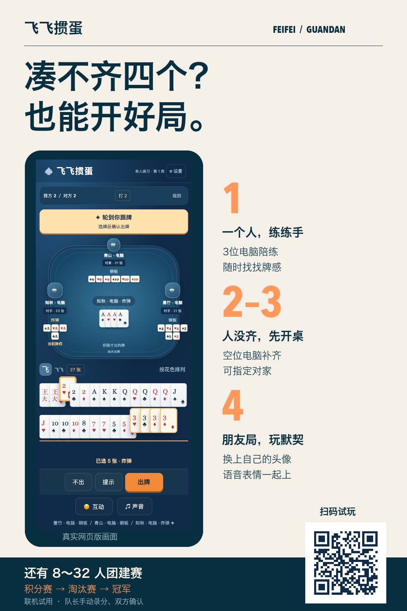
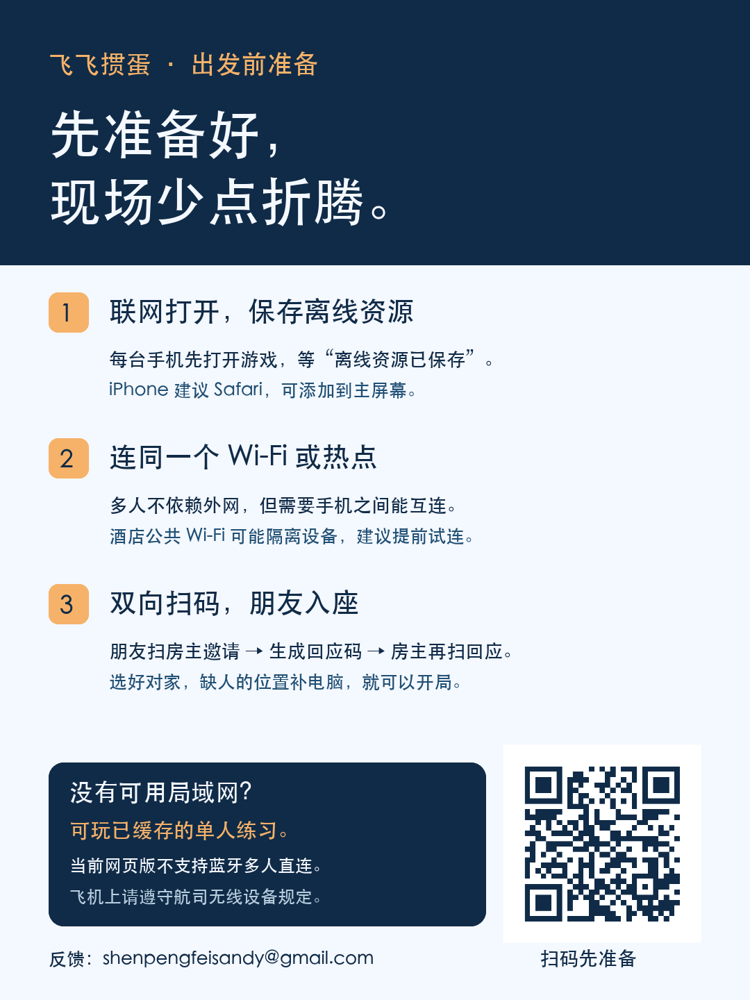
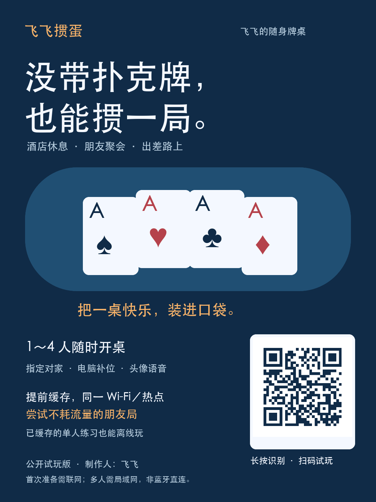

  

  <strong>没带扑克牌，也能掼一局。</strong> 
  一个人练牌，几个朋友开桌，一群同事争冠。

  <a href="https://guanyou-table-demo.netlify.app/"><strong>♠ 立即试玩</strong></a> ·
  <a href="https://guanyou-table-demo.netlify.app/live-event.html">🏆 团建联机试用</a> ·
  <a href="https://github.com/shenpengfeisandy-beep/feifei-guandan-feedback/issues/new/choose">💬 提建议</a> ·
  <a href="https://github.com/shenpengfeisandy-beep/feifei-guandan-feedback/raw/refs/heads/codex/product-feedback/media/feifei-social-v2.zip">↓ 下载朋友圈图文包</a>

---

## 今天，约谁来一局？

| 一个人，练练手 | 人没齐，先开桌 | 朋友局，玩默契 |
| :--- | :--- | :--- |
| 3位电脑陪练，随时找找牌感。 | 2～3位真人也能玩，空位电脑补齐。 | 4位朋友选好对家，隔位配合，从2打到A。 |

**不用注册，也不用 GitHub 账号。** 打开网页即可先试单人练习。朋友局需要同一可互连的 Wi-Fi／热点，并完成邀请、回应双向配对。

## 有牌局，也有朋友间的热闹

**认得出牌友**　换上自己的昵称和头像，局内也能修改。各座位保留最近出牌，牌权和行动更好辨认。

**轮到你，有帮手**　领出提示优先小点数；超时代打可选30、60、90、120秒或关闭（默认60秒）。只代当前一手，下回合仍由你操作。

**熟悉的房规，自己做主**　手动进贡、还贡，支持内贡和双大王抗贡。打A首次须一二游，第二/三次允许一三游；三次未过退回2。

**一桌人，有声有色**　原创竞技音乐、残局紧张段落、双角色神经语音和互动表情。战绩与休闲段位保存在本机，真人、人机、练习分榜。

## 人多？把聚会变成一场比赛

**8～32人，固定双人队：积分赛 → 淘汰赛 → 决赛及季军赛。**

组织者分桌、队长录分、双方确认，一起把赛程打完。当前团建联机为试用版，成绩由队长手动提交，尚不自动收取各桌游戏结果。

[打开团建联机试用 →](https://guanyou-table-demo.netlify.app/live-event.html)

## 出发前备好，旅途多一局

1. **先联网缓存。** 每台手机打开游戏，等待“离线资源已保存”；iPhone 建议 Safari。
2. **朋友连同一个网。** 使用允许设备互连的 Wi-Fi 或热点。酒店公共网络可能隔离设备，请提前试连。
3. **完成双向配对。** 朋友扫房主邀请、生成回应，再由房主扫回应；选对家、补电脑、开局。

**离线能力说清楚：**缓存后的单人练习可离线。多人需可用局域网，可尝试不耗外网流量联机；当前网页版没有蓝牙直连。飞机上若无可用局域网，可玩已缓存的单人练习，并遵守航司规定。首次打开及更新仍需互联网。

<strong>查看可保存的开局指南</strong>

## 你的下一条建议，可能就是下一次改进

配对哪里卡住了？按钮哪里不顺手？电脑哪一手打得不聪明？都欢迎告诉飞飞。

- **[提交问题或建议 →](https://github.com/shenpengfeisandy-beep/feifei-guandan-feedback/issues/new/choose)** 请附手机型号、浏览器、操作步骤及截图。
- **不用 GitHub 也能反馈：**[shenpengfeisandy@gmail.com](mailto:shenpengfeisandy@gmail.com?subject=飞飞掼蛋反馈)
- 请勿公开配对码、个人照片、牌友资料或完整存档。

## 把这桌快乐，分享给朋友

[保存主海报](media/poster.png) · [保存玩法图](media/features.png) · [保存开局指南](media/guide.png) · [复制朋友圈文案](朋友圈文案.md) · [下载三图与文案 ZIP](https://github.com/shenpengfeisandy-beep/feifei-guandan-feedback/raw/refs/heads/codex/product-feedback/media/feifei-social-v2.zip)

---

制作人：**飞飞** · 公开试玩版

本页仅公开产品介绍、宣传素材和反馈入口，**游戏源码私有**。画面中的界面来自真实浏览器测试截图；海报扑克牌为AI生成的宣传插画，不是游戏内画面。部分手机扫码、后台连接及大型真实团建场景仍待验证，尚未完成全部真机验收。宣传二维码打开游戏首页，加入朋友房间仍需双向配对。
